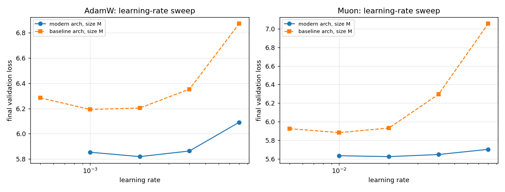
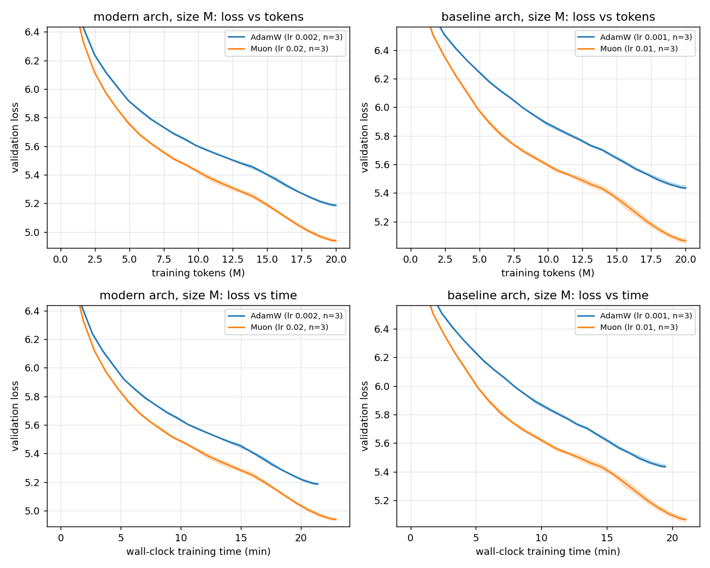

# Does Muon still beat a tuned AdamW? Small-scale ablations on a MacBook

I reproduced the main ideas of the [NanoGPT speedrun](https://github.com/KellerJordan/modded-nanogpt) (rotary embeddings, QK-Norm, ReLU², and the [Muon optimizer](https://kellerjordan.github.io/posts/muon/)) at small scale on an M4 MacBook Pro. Then I ran a follow-up study to test the first results properly, with tuned learning rates and three seeds per configuration.

## Key findings

1. **Muon beats a properly tuned AdamW.** On a 10.6M-parameter GPT trained for 20M tokens, Muon's final validation loss is **0.25 lower** than AdamW's (4.935 vs 5.182; seed std ≈ 0.007). It reaches AdamW's final loss with **75% of the tokens and 81% of the wall-clock time**: about 1.33× more efficient per token and 1.23× faster by the clock. That is close to the ~1.35× speedup Muon brought to the speedrun record.
2. **Using one learning rate for every configuration overstated the architecture gains by almost 3×.** My first ablation used AdamW at 3e-3 for every configuration and credited RoPE + QK-Norm + ReLU² with a 0.70 loss improvement. With each architecture at its own best learning rate, the improvement is **0.25**. The original architecture was mostly suffering from a learning rate that was too high for it.
3. **Muon and the architecture changes overlap much less once tuned.** Untuned, their gains overlapped by 0.41 loss: 1.39 if you add the separate gains, but only 0.98 combined. Tuned, the overlap is 0.12. Tuned Muon alone (0.37) is worth more than all three architecture changes together (0.25).
4. **Muon costs more time on Apple Silicon.** The optimizer step takes 9–10% of training time with Muon versus 3% with AdamW, so overall throughput is ~6–7% lower. The speedrun reports Muon's overhead as small on H100s.

## Setup

| | |
|---|---|
| Hardware | MacBook Pro (M4), PyTorch MPS backend, float32, no `torch.compile` |
| Data | FineWeb, GPT-2 tokenized ([`kjj0/fineweb10B-gpt2`](https://huggingface.co/datasets/kjj0/fineweb10B-gpt2)), 1 training shard |
| Model | GPT, 6 layers, 6 heads, width 384, context 512, untied 50,304-token embedding and output head; 10.6M non-embedding parameters |
| Training | Batch 16 × 512 = 8,192 tokens/step; 20M tokens (2,441 steps); 100-step warmup, constant, then linear decay to zero over the last 30% |
| Evaluation | Validation loss on a fixed set of 100 batches (819k tokens) from the FineWeb validation shard, the same for every run |
| AdamW | β = (0.9, 0.95), no weight decay |
| Muon | Nesterov momentum 0.95, 5 Newton-Schulz iterations, update scaled by √max(1, rows/cols). Applied to hidden 2-D weights only; embeddings and output head use AdamW at a fixed 3e-3 |

"Modern" architecture = RoPE + QK-Norm + ReLU². "Baseline" = learned absolute position embeddings + GELU. Both use pre-norm RMSNorm. Wall-clock time counts training steps only (data loading, forward, backward, optimizer), not evaluation.

## Part 1: Ablation (one learning rate, one seed)

Each technique added in turn, all with AdamW at 3e-3 (and Muon at 0.02 where used).

| Run | Configuration | Val loss | Change | Train time |
|---|---|---|---|---|
| 1 | Baseline | 5.907 | – | 19.8 min |
| 2 | + RoPE | 5.404 | −0.503 | 21.7 min |
| 3 | + RoPE + QK-Norm | 5.241 | −0.163 | 21.7 min |
| 4 | + RoPE + QK-Norm + ReLU² | 5.208 | −0.033 | 22.1 min |
| 5 | All + Muon | 4.929 | −0.279 (vs 4) | 24.0 min |
| 6 | Baseline + Muon | 5.221 | −0.686 (vs 1) | 21.2 min |

Run 6 raised the question for Part 2: Muon *alone* (−0.686) roughly matched all three architecture changes combined (−0.699). Was Muon fixing the same problem, or was the shared learning rate distorting the comparison?

## Part 2: Tuned comparison (learning-rate sweep, three seeds)

**Method.** For each architecture and optimizer, I swept the learning rate on short runs (5M tokens, 1 seed). I then trained 3 seeds for the full 20M tokens at the best learning rate. Every best value has a worse value on both sides.



| Arch | AdamW LR sweep (loss at 5M tokens) | Muon LR sweep (loss at 5M tokens) |
|---|---|---|
| Modern | 1e-3: 5.854 · **2e-3: 5.819** · 4e-3: 5.864 · 8e-3: 6.091 | 0.01: 5.633 · **0.02: 5.623** · 0.04: 5.646 · 0.08: 5.702 |
| Baseline | 5e-4: 6.284 · **1e-3: 6.193** · 2e-3: 6.204 · 4e-3: 6.353 · 8e-3: 6.871 | 0.005: 5.925 · **0.01: 5.882** · 0.02: 5.931 · 0.04: 6.294 · 0.08: 7.055 |

**Results** (mean ± std over 3 seeds, 20M tokens):

| Arch | Optimizer | LR | Final val loss | Throughput | Optimizer share of time | Muon's budget to match AdamW (tokens / time) |
|---|---|---|---|---|---|---|
| Modern | AdamW | 2e-3 | 5.182 ± 0.007 | 15.6k tok/s | 3% | |
| Modern | Muon | 0.02 | **4.935 ± 0.006** | 14.6k tok/s | 9% | **75% / 81%** |
| Baseline | AdamW | 1e-3 | 5.430 ± 0.011 | 17.1k tok/s | 3% | |
| Baseline | Muon | 0.01 | **5.064 ± 0.015** | 15.9k tok/s | 10% | **70% / 75%** |



### Interpretation

**Muon's advantage is not an artifact of a poorly tuned baseline.** Tuning AdamW shrank Muon's lead on the modern architecture only slightly (0.279 → 0.247). The remaining gap is more than 15 times the seed-to-seed standard deviation. Muon at 0.02 also reproduced across Parts 1 and 2 (4.929 vs 4.935).

**The architecture gains were mostly about learning-rate tolerance.** At 3e-3 the baseline reached 5.907. At its own best learning rate (1e-3) it reaches 5.430, a 0.48 improvement from tuning alone. The modern architecture prefers a higher learning rate (2e-3) and degrades less above its optimum, which fits QK-Norm's stated purpose of keeping attention logits from saturating. A plausible reading is that much of what RoPE and QK-Norm contributed in Part 1 was making a high learning rate safe, not adding capacity. I did not isolate each change under tuning, so this is a hypothesis.

**Tuned gains, side by side:**

| Comparison | Untuned (Part 1) | Tuned (Part 2) |
|---|---|---|
| Architecture gain (AdamW, baseline → modern) | 0.699 | 0.248 |
| Muon gain on baseline architecture | 0.686 | 0.367 |
| Muon gain on modern architecture | 0.279 | 0.247 |
| Both combined (baseline AdamW → modern Muon) | 0.978 | 0.495 |
| Overlap (sum of separate gains − combined) | 0.407 | 0.120 |

## Limitations

- **One model size, a short training budget.** 20M tokens is far below the compute-optimal budget for a 10.6M-parameter model, so these results describe early training. Whether Muon's advantage grows or shrinks with scale is untested here.
- **Learning rates were chosen from short runs.** The sweep used 5M-token single-seed runs; longer runs sometimes prefer slightly lower rates. Baseline AdamW was nearly flat between 1e-3 and 2e-3 (6.193 vs 6.204), so its true optimum likely lies between them. That would change its final loss by less than ~0.01.
- **Embedding learning rate in Muon runs was not tuned.** It was fixed at 3e-3, which could favor or penalize Muon.
- **Part 1 is single-seed**, and its final evaluation used 20 validation batches rather than 100. Its numbers are directionally reliable, but small differences such as ReLU²'s 0.033 should not be over-read. The measured seed std (~0.01) suggests that one may still be real.
- **Hardware-specific timing.** Wall-clock comparisons reflect MPS in float32 without kernel fusion. Muon's relative overhead would likely be smaller on a CUDA GPU with bfloat16 and `torch.compile`.

## Reproduce

```bash
pip install torch numpy matplotlib huggingface_hub
python3 prepare_data.py                      # validation shard + 1 training shard (~400 MB)

# Part 1: ablation (~2.2 h on an M4)
bash run_ablations.sh

# Part 2: tuned comparison (~6 h for size M); resumable, Ctrl+C and rerun to continue
python3 sweep.py lr    --sizes M
python3 sweep.py lr    --sizes M --arch base
python3 sweep.py final --sizes M
python3 sweep.py final --sizes M --arch base
python3 analyze.py                           # figures + results/results.md
```

| File | Purpose |
|---|---|
| `train.py` | Model, Muon optimizer, training loop; every technique is a command-line flag |
| `prepare_data.py` | Downloads pre-tokenized FineWeb shards |
| `run_ablations.sh`, `compare.py` | Part 1 ablation and its plot |
| `sweep.py` | Part 2: resumable learning-rate sweep and multi-seed final runs |
| `analyze.py` | Part 2 figures and summary table |

## References

- K. Jordan et al., [Muon: An optimizer for hidden layers in neural networks](https://kellerjordan.github.io/posts/muon/), 2024
- J. Liu et al. (Kimi Team), [Muon is Scalable for LLM Training](https://arxiv.org/abs/2502.16982), 2025
- K. Jordan et al., [modded-nanogpt / NanoGPT speedrun](https://github.com/KellerJordan/modded-nanogpt)
- J. Su et al., [RoFormer: Enhanced Transformer with Rotary Position Embedding](https://arxiv.org/abs/2104.09864), 2021
- A. Henry et al., [Query-Key Normalization for Transformers](https://arxiv.org/abs/2010.04245), 2020
- D. So et al., [Primer: Searching for Efficient Transformers for Language Modeling](https://arxiv.org/abs/2109.08668), 2021 (squared ReLU)

## Acknowledgments

Built on ideas and the Muon implementation from the modded-nanogpt speedrun. Code written with assistance from Claude (Anthropic); experiments, runs and analysis by me.
